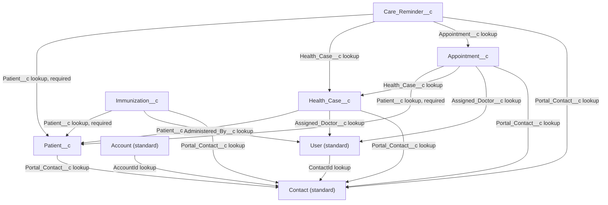

# HealthConnect — Deployed Project Guide

## Audit scope and evidence

**Audit date:** 2026-10-23  
**Target org:** `HealthConnectOrg`  
**Verified org ID:** `00DgK00000cTMbxUAG`  
**Connected username:** `talvix529.85a080cd1b81@agentforce.com`  
**Salesforce API version used:** 68.0

The Salesforce CLI confirmed that `HealthConnectOrg` is connected. All org-specific conclusions below come from read-only metadata, Tooling API queries, site configuration, test-result records, and scheduled-job metadata for that alias. No records were queried, no Apex tests were run, no metadata was deployed or changed, and no email action was invoked.

This guide distinguishes:

- **Configured/traceable:** deployed metadata and an active entry point establish how a component is intended to participate.
- **Test-context verified:** a previously recorded Apex test passed. This proves only the assertions in that isolated test context.
- **Runtime verified:** evidence from an actual application transaction, portal session, Flow interview, or delivered email. This audit found no Apex debug logs and did not verify an external-user session or email delivery.

Consequently, “active” and “deployed” do not by themselves mean that a complete user workflow has been proven end to end.

### Current status at a glance

- Four HealthConnect Flows have active versions.
- All nine deployed Apex triggers are `Active`.
- Three HealthConnect production Apex classes are traceable to active application paths.
- Seven deployed HealthConnect custom objects are relevant to the model; `Doctor__c` is not the object used by case doctor assignment.
- The Experience Cloud network and sites are active/live. The retrieved `healthconnect1` Home page places the patient dashboard component.
- Latest recorded relevant Apex tests passed on 2026-10-21. No tests were executed for this audit.
- No Apex debug logs were retained (`ApexLog` query returned zero rows). No patient-specific portal login, Flow interview, or email delivery was verified.

## 1. Deployed data model

The following relationships are taken from the deployed field metadata. Every custom relationship shown is a **Lookup**, not a Master-Detail relationship. Required lookups are marked `required`.

`Doctor__c` has no lookup to `User` or to `Health_Case__c` in the deployed schema. Case and appointment doctor assignment instead uses `Assigned_Doctor__c`, a lookup to the standard `User` object. `HealthConnect_Access_Grant__c` stores target object, record, and user identifiers as text; these are not enforced Salesforce relationships.

| Deployed object | Type and role | Important fields and relationships | Required fields / notable configuration |
|---|---|---|---|
| `Patient__c` (label **Patient**) | Custom object; central patient record. | `Date_of_Birth__c`, `Gender__c`, `Blood_Group__c`, `Patient_Status__c`, `Phone_Number__c`, `Email__c`, `Address__c`, `Village__c`, `District__c`, `State__c`; `Portal_Contact__c` → `Contact`. | Patient name is the object’s name field. No custom patient-information validation rule was found. Email and contact association are not schema-required. |
| `Health_Case__c` (label **Health Case**) | Custom object for intake, review, and follow-up. This is **not** Salesforce’s standard `Case` object. | Required `Patient__c` → `Patient__c`; `Case_Priority__c`, `Case_Status__c`, `Symptoms__c`, `Symptom_Duration_Days__c`, `Diagnosis__c`, `Doctor_Recommendation__c`, `Follow_up_Date__c`, `Appointment_Required__c`; `Assigned_Doctor__c` → `User`; `Portal_Contact__c` → `Contact`. | `Patient__c`, `Case_Priority__c`, and `Case_Status__c` are required by field metadata. Active validation rules require clinical details for a particular status and a follow-up date when follow-up is required. |
| `Appointment__c` (label **Appointment**) | Custom scheduled visit. | Required `Patient__c` → `Patient__c`; optional `Health_Case__c` → `Health_Case__c`; `Appointment_Date__c`, `Appointment_Time__c`, `Appointment_Status__c`, `Appointment_Notes__c`; `Assigned_Doctor__c` → `User`; `Portal_Contact__c` → `Contact`. | Patient is schema-required. An active validation rule also requires a Health Case, date, and time. |
| `Care_Reminder__c` (label **Care Reminder**) | Custom due item; can be associated with a patient, case, and appointment. | Required `Patient__c` → `Patient__c`, `Reminder_Type__c`, `Reminder_Status__c`; optional `Health_Case__c` → `Health_Case__c`, `Appointment__c` → `Appointment__c`, `Due_Date__c`, `Reminder_Notes__c`, and `Portal_Contact__c` → `Contact`. | A record-triggered Flow, not a Validation Rule, requires a due date only for a newly created reminder with status `Pending`. |
| `Immunization__c` (label **Immunization**) | Custom record of an administered vaccine dose. | Required `Patient__c` → `Patient__c`, `Vaccine_Name__c`, `Date_Administered__c`; optional `Dose__c`, `Next_Due_Date__c`, `Administered_By__c` → `User`, `Portal_Contact__c` → `Contact`. | No active rule or Flow was found that turns `Next_Due_Date__c` into an appointment or reminder automatically. |
| `Doctor__c` (label **Doctor**) | Custom directory-like record with `Specialization__c`, `Healthcare_Facility__c`, `District__c`, `Availability_Status__c`, `Phone_Number__c`, and `Email__c`. | No relationship to case assignment was found. | Deployed, but not in the traced assignment path; assignment uses a Salesforce `User`. |
| `HealthConnect_Access_Grant__c` (label **HealthConnect Access Grant**) | Private, system-managed bookkeeping for access grants. | `Target_Object__c`, `Target_Record_Id__c`, `Target_User_Id__c`, `Access_Level__c`, `Previous_Access_Level__c`, and `Grant_Key__c`. | Required fields are present. The deployed profile/permission configuration does not provide normal user CRUD access; an active trigger blocks direct changes unless the sharing service is mutating grants. |
| `Contact` (standard) | Standard contact used to associate an external user and patient. | Standard `AccountId`; a portal user has `User.ContactId`; patient and child records have custom `Portal_Contact__c` lookups. | Patient Contact matching is configured by a Sharing Set. |
| `User` (standard) | Internal care-team member or external portal user. | `ContactId` identifies the external user’s Contact; `Assigned_Doctor__c` fields reference `User`. | A matching doctor `User` is required for doctor assignment; no automatic `Doctor__c`-to-User mapping was found. |

Relevant deployed picklist values include:

- Case priority: `Low`, `Medium`, `High`, `Urgent`.
- Case status: `New`, `Under Review`, `Recommendation Provided`, `Follow-up Required`, `Closed`.
- Reminder type: `Immunization`, `Routine Check-up`, `Follow-up`.
- Reminder status: `Pending`, `Sent`, `Completed`, `Cancelled`.
- Appointment status: `Scheduled`, `Completed`, `Cancelled`, `Rescheduled`.
- Appointment time: `09:00 AM`, `10:00 AM`, `11:00 AM`, `02:00 PM`, `03:00 PM`, `04:00 PM`.

### Data-model usage examples

- A Health Worker creates a `Patient__c` and associates it with a Contact through `Portal_Contact__c` when portal access is needed.
- A `Health_Case__c` must reference a Patient and has a required priority and status. The assigned clinician is a `User`.
- A `Care_Reminder__c` may point to the case and, when a matching scheduled appointment exists, to that appointment.
- A patient’s administered dose is stored as an `Immunization__c`; `Next_Due_Date__c` is stored data, not proof of a generated reminder.

## 2. Active validation rules and record requirements

Four active deployed Validation Rules were found:

| Rule API name | Object | Enforced condition | User-facing result |
|---|---|---|---|
| `Recommendation_Requires_Clinical_Fields` | `Health_Case__c` | If `Case_Status__c = "Recommendation Provided"`, `Diagnosis__c` and `Doctor_Recommendation__c` must both be populated. | “Enter a diagnosis and doctor recommendation before marking the case Recommendation Provided.” |
| `Follow_Up_Requires_Date` | `Health_Case__c` | If `Case_Status__c = "Follow-up Required"`, `Follow_up_Date__c` must be populated. | “Enter a follow-up date before marking the case Follow-up Required.” |
| `Doctor_Cannot_Change_Patient_Or_Priority` | `Health_Case__c` | For profile name `HealthConnect Doctor`, changes to `Patient__c` or `Case_Priority__c` are rejected. | “Doctors cannot change the patient or priority on a Health Case.” |
| `Appointment_Requires_Scheduling_Details` | `Appointment__c` | Requires `Patient__c`, `Health_Case__c`, `Appointment_Date__c`, and `Appointment_Time__c`. | “Enter a Patient, Health Case, Appointment Date, and Appointment Time before saving.” |

The appointment rule’s formula checks those fields unconditionally, although its description says “a scheduled appointment.” Do not describe the actual rule as conditional on `Appointment_Status__c = Scheduled`.

**How to explain enforcement:** schema-required fields are enforced by Salesforce whenever a record is saved; Validation Rules reject a save when their formula evaluates true; Flows can route or raise a Flow error as part of configured automation; Apex performs custom transaction logic. These mechanisms are complementary, not interchangeable. The case rules above are Validation Rules; the Pending-reminder due-date check is Flow logic.

## 3. Active Flow inventory

Four application Flows have an active version. The Flow version IDs below were queried directly from `Flow` in `HealthConnectOrg`; `FlowDefinition.ActiveVersionId` was checked rather than inferred from local source files.

| Flow label / API name | Active version | Type and entry | Status / runtime evidence |
|---|---|---|---|
| **Care Reminder Processing** / `Care_Reminder_Processing` | v3, `301gK00001fvO3vQAE` | Record-triggered, before-save on `Care_Reminder__c`, create only, when `Reminder_Status__c = Pending`. | Active. Its supported-type and missing-due-date behavior is exercised by `CareReminderProcessingTest`; no production transaction log was found. |
| **Create or Update Case Follow-up Reminder** / `Create_or_Update_Case_Follow_Up_Reminder` | v2, `301gK00001dGuC9QAK` | Record-triggered, after-save on `Health_Case__c`, create and update. Entry requires status `Follow-up Required`, nonblank `Follow_up_Date__c`, and nonblank `Patient__c`. | Active and configuration-traceable. No test-result evidence specific to this Flow was found. |
| **Schedule Appointment From Case** / `Schedule_Appointment_From_Case` | v3, `301gK00001ftSpyQAE` | Screen Flow launched by the `Health_Case__c.Schedule_Appointment` Quick Action. The action is present on the deployed Health Case layout. | Active and page-action-traceable. No Flow interview or delivery evidence was found. Completing it is configured to attempt an appointment confirmation email. |
| **Scheduled Care Reminder Automation** / `Scheduled_Care_Reminder_Automation` | v4, `301gK00001fzM73QAE` | Daily scheduled Flow on pending `Care_Reminder__c` records. It is configured to start 2026-10-13 at 3:00 PM in the org timezone (`America/Los_Angeles`). | Active. A scheduled job is `WAITING`, has a previous fire time of 2026-10-22 22:00 UTC, and a next fire time of 2026-10-23 22:00 UTC. This proves scheduler activity, not a successful Flow interview or email delivery. |

### Flow behavior

#### `Care_Reminder_Processing` — v3

1. Runs before save when a new Care Reminder is `Pending`.
2. Routes only `Follow-up`, `Immunization`, or `Routine Check-up` reminder types. An unsupported value produces a field-level Flow error.
3. Requires `Due_Date__c`; otherwise it reports “A due date is required for a Pending care reminder.”
4. It does not create or update any record and does not send email.

The important decisions are `Route_Reminder_Type` and `Check_Due_Date`; the field-level errors are `Reject_Unsupported_Reminder_Type` and `Reject_Missing_Due_Date`. **Example:** creating a Pending Immunization reminder with a due date passes these checks; leaving its due date blank prevents the save.

The object’s required fields separately require Patient, Reminder Type, and Reminder Status. The Flow’s due-date check applies to **creation of Pending records**, not every update or every reminder status.

#### `Create_or_Update_Case_Follow_Up_Reminder` — v2

1. Runs after a Health Case is created or updated when it is `Follow-up Required` and has both Patient and follow-up date.
2. `Get_Existing_Follow_Up_Reminder` looks up a Care Reminder for the same case and type `Follow-up`; `Check_Existing_Reminder` routes an existing result to the status check or no result to creation.
3. `Get_Matching_Appointment` looks for an appointment on the same case and patient, with a date matching the follow-up date and status `Scheduled`.
4. If there is no matching reminder, creates a `Pending` Follow-up reminder, links the case and patient, and links the matching appointment if one was found.
5. `Check_Reminder_Status` routes an existing Pending reminder to `Update_Pending_Follow_Up_Reminder`, which sets its patient and due date and sets its Appointment link to the lookup result (blank when no matching appointment exists).
6. A matching reminder in a terminal/non-Pending status is left unchanged.

This Flow can create a Care Reminder, which then enters the reminder before-save Flow and runs the Care Reminder contact-sync and sharing triggers as applicable. It does not itself send an email.

**Example:** a case is saved as Follow-up Required for a patient with a follow-up date; a Pending reminder is created and linked to a Scheduled appointment on that date if one exists.

#### `Schedule_Appointment_From_Case` — v3

1. The `Schedule Appointment` record action is the Flow entry point; it is included on `Health_Case__c-Health Case Layout`.
2. The Flow receives `recordId`, `Get_Health_Case` looks up the Health Case, and `Enter_Appointment_Details` presents required appointment date and time plus optional notes.
3. `Create_Appointment` creates an `Appointment__c` with status `Scheduled`, deriving Patient, Health Case, and Assigned Doctor from the case.
4. `Send_Appointment_Confirmation_Email` has an `emailSimple` action addressed to `Patient__r.Email__c` with a static appointment-confirmation message; `Appointment_Created` then presents the confirmation screen.

The Flow does not contain an Apex action. Creating the Appointment invokes the active Appointment triggers. The deployed email action is an **attempt configured in the Flow**; no queued/accepted, delivered, or received email was verified. Do not complete this Flow as a live demo action unless email behavior and a safe recipient have been deliberately arranged.

**Example:** a Health Worker opens a Health Case, clicks Schedule Appointment, selects one of the available appointment times, and submits the screen. This creates the Appointment and reaches the configured email action and confirmation screen.

#### `Scheduled_Care_Reminder_Automation` — v4

1. Runs daily on Care Reminders whose status is `Pending`.
2. `Check_Reminder_Due_Date` compares `Due_Date__c` with `$Flow.CurrentDate + 2`.
3. `Get_Patient_Record` retrieves the linked Patient; `Check_Patient_Email` checks `Patient__c.Email__c`.
4. If the email is present, `Send_Patient_Care_Reminder` calls `emailSimple` with subject `Care reminder` and the configured reminder text.
5. `Mark_Due_Reminder` updates the reminder status to `Sent` after that action.
6. If the email is blank or the date is not due, the configured decision path does not send or mark the reminder Sent.

The status `Sent` is the Flow’s configured post-action state; it is not proof that a mail server accepted, delivered, or that a patient received the email. The active version is v4 even though `FlowDefinition.LatestVersionId` points to v6; v6 is a draft and is not the version explained here.

**Example:** a Pending reminder due in two days is selected; if the Patient has `Email__c`, the Flow attempts the message and then updates the status.

### Flow exclusions and legacy automation

- `sfdc_default_ReportExport_Protection_Flow` has no active version and is not a HealthConnect workflow.
- The retrieved `Case.workflow-meta.xml` contains a field-update definition (`ChangePriorityToHigh`) but no Workflow Rule that invokes it. No active HealthConnect Workflow Rule or Process Builder path was established.
- The active Flow query returned the four application Flows above; it did not show an active Process Builder Flow.
- The scheduled reminder job is the only HealthConnect-specific scheduled job identified. Other scheduled jobs in the org are Salesforce/platform jobs and are not part of the patient-care workflow.

## 4. Deployed Apex triggers

All nine triggers below are present and have Tooling API `Status = Active`. Trigger source was read from `HealthConnectOrg`; the nine workspace trigger files were also found to match the retrieved org source after normalizing line endings.

| Trigger | Object and events | Purpose, called method, and affected data | Workflow / evidence |
|---|---|---|---|
| `AppointmentPortalContactSync` | `Appointment__c`; before insert, before update | Calls `HealthConnectPatientContactSync.syncAppointments(Trigger.new)`. Copies the Patient’s `Portal_Contact__c` onto the Appointment’s `Portal_Contact__c`. | Supports contact-based patient portal sharing. Appointment creation by the screen Flow reaches this trigger. Contact-sync test passes in test context. |
| `AppointmentSharing` | `Appointment__c`; after insert, after update | Calls `HealthConnectSharingService.syncAppointmentsForRecords`. Recalculates managed Appointment shares for the related case/appointments and old case on update. | Shares the appointment with the related case owner and assigned doctor; invoked after screen Flow or other Appointment DML. Sharing-service test passes in test context. |
| `CareReminderPortalContactSync` | `Care_Reminder__c`; before insert, before update | Calls `HealthConnectPatientContactSync.syncCareReminders(Trigger.new)` and copies the Patient’s portal Contact. | Supports the Sharing Set lookup. Runs when the case Flow creates a reminder and when the scheduled Flow changes its status. |
| `CareReminderSharing` | `Care_Reminder__c`; after insert, after update | Calls `HealthConnectSharingService.syncRemindersForRecords`, supplying old records on update. | Keeps care-team access in sync; case-linked reminders are shared with case owner and assigned doctor at the configured levels. |
| `HealthCasePortalContactSync` | `Health_Case__c`; before insert, before update | Calls `HealthConnectPatientContactSync.syncHealthCases(Trigger.new)` and copies the Patient’s portal Contact. | Supports contact-based portal sharing of a Health Case. |
| `HealthCaseSharing` | `Health_Case__c`; after insert, after update | Calls `HealthConnectSharingService.syncHealthCases`, supplying `Trigger.oldMap` on update. | Reconciles case, patient, appointment, and reminder shares when the case owner or assigned doctor changes; recalculates patient shares when the patient association changes. |
| `HealthConnectAccessGrantGuard` | `HealthConnect_Access_Grant__c`; before insert, before update, before delete | Calls `HealthConnectSharingService.isGrantMutationInProgress()`. Adds an error to every attempted change unless the sharing service’s internal mutation flag is set. | Protects system-managed grant tracking from direct writes. The sharing test asserts direct grant manipulation is rejected. |
| `ImmunizationPortalContactSync` | `Immunization__c`; before insert, before update | Calls `HealthConnectPatientContactSync.syncImmunizations(Trigger.new)` and copies the Patient’s portal Contact. | Enables the external-user Sharing Set to match immunization records. |
| `PatientPortalContactSync` | `Patient__c`; after update | Calls `HealthConnectPatientContactSync.syncChildrenForPatients(Trigger.new, Trigger.oldMap)`. If the patient’s portal Contact changed, updates linked Health Cases, Appointments, Care Reminders, and Immunizations to the new Contact. | Keeps dependent record sharing aligned after Contact reassignment. The service uses system-mode queries and updates for this internal synchronization; the contact-sync test passed. |

### Trigger/Apex behavior and overlap

The contact-sync triggers maintain `Portal_Contact__c`; they do not create patients or grant arbitrary user access. The sharing triggers maintain manual share rows for care-team users and track changes in `HealthConnect_Access_Grant__c`. The `HealthConnect_Patient_Portal` Sharing Set separately provides external users read access to records whose portal Contact matches their Contact.

Flows can create/update records that cause these triggers to run, but the Flows do not duplicate the trigger logic. For example, the case follow-up Flow creates the reminder while the reminder Flow checks its valid creation data, the before trigger synchronizes its Contact, and the after trigger reconciles any case-related shares.

No Apex debug logs were retained. The tests support selected behavior in test transactions, not an observed live user transaction for every trigger event.

## 5. Deployed Apex classes in HealthConnect paths

### A. Active and traceable, with passing test-context evidence

#### `HealthConnectPatientContactSync`

- **Deployed identity:** `ApexClass` `HealthConnectPatientContactSync` (`01pgK00000IbiirQAB`), API version 67, status Active.
- **Callers:** the five `*PortalContactSync` triggers listed above.
- **Purpose:** derive a child care record’s portal Contact from its Patient, and propagate Contact changes from a Patient to existing related records.
- **Important methods:** `syncHealthCases`, `syncAppointments`, `syncCareReminders`, `syncImmunizations`, and `syncChildrenForPatients`.
- **Data effects:** sets `Portal_Contact__c` on Health Case, Appointment, Care Reminder, and Immunization records; when a Patient Contact changes, queries and updates those existing child records.
- **Test:** `HealthConnectPatientContactSyncTest.copiesPortalContactToRelatedCareAndRefreshesWhenChanged` passed on 2026-10-21. It asserts the new Contact is reflected on all four child record types.
- **Verification:** active trigger references plus a passing test establish a traceable and test-supported path. No production debug log was available.
- **Workspace source:** [`HealthConnectPatientContactSync.cls`](force-app/main/default/classes/HealthConnectPatientContactSync.cls) matches the retrieved org class.

#### `HealthConnectSharingService`

- **Deployed identity:** `ApexClass` `HealthConnectSharingService` (`01pgK00000IMIbpQAH`), API version 67, status Active.
- **Callers:** `HealthCaseSharing`, `AppointmentSharing`, and `CareReminderSharing` call the share-reconciliation methods; `HealthConnectAccessGrantGuard` calls `isGrantMutationInProgress`.
- **Purpose:** reconcile manual shares and keep care-team access aligned with the case owner and assigned doctor.
- **Important methods:** `syncHealthCases`, `syncAppointmentsForRecords`, `syncRemindersForRecords`, `isGrantMutationInProgress`, plus private share reconciliation and helper methods.
- **Data effects:** writes manual share records for `Health_Case__c`, `Patient__c`, `Appointment__c`, and `Care_Reminder__c`; creates, updates, and removes corresponding `HealthConnect_Access_Grant__c` tracking records. Case access for the assigned doctor is Edit; patient access to case owner/assigned doctor is Read; appointment access to case owner/assigned doctor is Edit; reminder access is Edit for case owner and Read for assigned doctor. Stale service-managed shares are removed or their prior access level restored.
- **Guardrails:** changing managed shares is restricted in code to the record owner or a user with Modify All Data. Grant-record DML uses system mode only while the service’s mutation flag is enabled; the guard trigger rejects direct attempts.
- **Test:** `HealthConnectSharingServiceTest.sharesAssignedCareAndRemovesStaleDoctorAccess` passed on 2026-10-21. Its assertions cover assigned/stale doctor access, profile editing restrictions, and blocking direct grant changes.
- **Verification:** active trigger references and passing assertions establish a traceable, test-supported path. No production debug log was available.
- **Workspace source:** [`HealthConnectSharingService.cls`](force-app/main/default/classes/HealthConnectSharingService.cls) matches the retrieved org class.

### B. Deployed and referenced; external-user runtime not verified

#### `HealthConnectPatientDashboardController`

- **Deployed identity:** `ApexClass` `HealthConnectPatientDashboardController` (`01pgK00000IbiitQAB`), API version 67, status Active.
- **Entry point:** `healthConnectPatientDashboard` imports and calls `getDashboard()`. The component is placed on the Home view of the live `healthconnect1` Experience Bundle.
- **Purpose and data returned:** gets the current User’s `ContactId`, finds exactly one `Patient__c` whose `Portal_Contact__c` is that Contact, and returns the patient plus up to 50 immunizations, pending/sent reminders, and scheduled/rescheduled appointments.
- **Access behavior:** the class is `with sharing`; the care-record queries use `WITH USER_MODE`. It raises an Aura-handled error for a missing Contact link, no Patient, or multiple linked Patients.
- **Test:** `HealthConnectPatientDashboardTest.returnsOnlyRecordsForTheLinkedPatient` and `rejectsContactsWithoutALinkedPatient` passed on 2026-10-21. The tests call the `@TestVisible` helper with a Contact ID under a Health Worker test user; they do **not** sign in as a real Experience Cloud patient user or prove a published portal session.
- **Verification:** the component, active page placement, class reference, profile access, and tests are traceable. Actual external-user invocation and user-mode sharing behavior remain runtime-unverified.
- **Source note:** the workspace copy of this controller did not match the retrieved org class; the deployed org version is the authority for this explanation.

### C. Excluded from the HealthConnect business-path explanation

The org also contains standard Experience Cloud login, registration, password, and profile helper classes, their test classes, and packaged Developer Edition utilities. They were not included as HealthConnect clinical workflow components because no HealthConnect business-data path to them was established. This is not a claim that Salesforce never invokes its standard authentication helpers.

## 6. Experience Cloud portal and access controls

### Configured sites and page placement

- The `healthconnect` Network is `Live`; its Experience Builder site `healthconnect1` is `Active` (path `/s`). The retrieved Experience Bundle is `healthconnect1`.
- The `healthconnect1` Home view places `c:healthConnectPatientDashboard` in its content region. Its login view places `c:healthConnectPortalWelcome`.
- The dashboard LWC is deployed, exposed to `lightningCommunity__Page`, and imports `HealthConnectPatientDashboardController.getDashboard`.
- The Experience Bundle config has `isAvailableToGuests = false`; its login view still places the welcome component. The dashboard LWC contains guest/login UI, but guest rendering was not tested and the site configuration does not make the site available to guests.
- A second Network named `HealthConnect Patient Portal` is also `Live`, with an active site `HealthConnect_Patient_Portal1` and a separate URL path. It is a distinct site configuration; the retrieved `healthconnect1` Home page is the one that establishes the dashboard placement described above.
- Both Network configurations have self-registration disabled. A patient account therefore depends on separately provisioned Salesforce external-user/contact setup; this audit did not inspect individual user records.

### Patient-specific access configuration

- The deployed external sharing model for Patient, Health Case, Appointment, Care Reminder, Immunization, Doctor, and Access Grant is `Private`.
- Sharing Set `HealthConnect_Patient_Portal` grants **Read** access to Patient, Health Case, Appointment, Care Reminder, and Immunization when the signed-in user’s Contact matches each record’s `Portal_Contact__c`.
- The Sharing Set includes profiles `HealthConnect Patient Community User` and `customer community plus login user`.
- The corresponding portal profile/permission set grants read-only object access to Patient, Health Case, Appointment, Care Reminder, and Immunization and exposes the dashboard controller. The Sharing Set and explicit Apex controller query filter are separate safeguards.
- The dashboard’s Patient lookup is based on `User.ContactId` → `Contact` → `Patient__c.Portal_Contact__c`. The sync triggers copy that Contact lookup to the child records.
- The portal profile metadata marks `Patient__c.Portal_Contact__c` editable even though Patient object-level profile access is read-only; the named portal permission set marks it read-only. This field-level configuration difference should be reviewed, but the profile’s object-level permissions do not grant Patient record edit access.
- More importantly, the controller’s `WITH USER_MODE` queries select/filter fields for which no read permission entry was found in either the `HealthConnect Patient Community User` profile or `HealthConnect_Patient_Portal_Access`: `Immunization__c.Vaccine_Name__c`, `Immunization__c.Date_Administered__c`, `Care_Reminder__c.Reminder_Type__c`, `Care_Reminder__c.Reminder_Status__c`, and `Appointment__c.Patient__c`. These fields are used directly in the dashboard queries. This is a likely runtime blocker unless another permission set assigned to a specific user supplies the missing access; user assignments were not inspected. Treat the portal as **configured but not verified and potentially blocked by field-level security**, not as a working end-to-end feature.
- The Health Worker and Doctor profiles/permission sets define distinct object and field permissions. `HealthConnect_Doctor` permits case review/edit while restricting the patient and priority intake fields; the active validation rule additionally prevents doctors from changing those values.

### What the deployed dashboard does—and does not do

The deployed controller is configured to query patient profile details, immunization history, care reminders, and appointments. It does **not** query or render `Health_Case__c` records. Although the Sharing Set includes Health Cases, do not claim that the custom dashboard displays case diagnoses or recommendations. The missing field-level read entries noted above may prevent its user-mode queries from succeeding.

The metadata proves the site is live, the component is deployed, and the Home page contains it. It does not prove that a particular external user can log in, that their records are visible in a browser session, or that every user’s permission-set assignments are correct. The portal tests use an internal Health Worker context, not a real external user session. The baseline external profile and named permission set also appear to lack read access to multiple fields selected/filtered by the controller’s `WITH USER_MODE` queries. End-to-end patient-specific access therefore remains unverified and may be blocked by field-level security.

## 7. Actual business process and verification status

| Business step | Deployed path | Status |
|---|---|---|
| Patient registration / creation | `Patient__c` can be created as a HealthConnect record; Patient-to-Contact association is an optional `Portal_Contact__c` lookup. Network self-registration is disabled; no active Flow/Apex automatic patient registration was found. | **Partially implemented:** patient records and linking are configured, but automatic portal registration/creation is not implemented in the deployed configuration. |
| Health Case creation and patient association | Health Worker creates `Health_Case__c`; required Patient and case priority/status fields apply. Before-save trigger copies portal Contact. | **Configured, runtime-unverified:** schema and permissions establish the path; no live transaction was observed. |
| Doctor assignment and case review | Case `Assigned_Doctor__c` references a Salesforce `User`. `HealthCaseSharing` shares the case with the assigned doctor; Doctor profile/permission configuration controls review. | **Test-context verified for sharing behavior;** no real doctor session was observed. `Doctor__c` is not the assignment relationship. |
| Diagnosis, recommendation, and follow-up | Case fields hold diagnosis/recommendation. Active Validation Rules require both before `Recommendation Provided` and require a date for `Follow-up Required`. | **Configured and rule logic verified by metadata;** no live case update was tested. |
| Appointment creation / scheduling | Health Case layout action `Health_Case__c.Schedule_Appointment` launches `Schedule_Appointment_From_Case` v3, which creates a Scheduled Appointment and attempts a confirmation email. | **Configured, runtime-unverified.** No Flow interview, appointment transaction, or email delivery was verified. |
| Immunization record management | Health Worker can create/update `Immunization__c`; required patient, vaccine name, and administration date apply. The dashboard controller is configured to query immunization history, but baseline external-user field access appears incomplete for fields in that query. | **Configured, runtime-unverified.** No automatic dose or next-visit scheduling was found. |
| Care Reminder creation and due-date processing | Follow-up case Flow v2 creates/updates a pending Follow-up reminder; before-save Flow v3 validates new Pending reminders. | **Configured; reminder validation test-context verified.** The case-to-reminder Flow itself has no specific result evidence. |
| Scheduled reminder email | Scheduled Flow v4 runs daily for Pending reminders due in two days, checks `Patient__c.Email__c`, invokes `emailSimple`, then sets status to Sent. A WAITING CronTrigger has previous/next fire times. | **Scheduler configured and active; email execution/delivery unverified.** No test email was sent. |
| Patient access through Experience Cloud | Live network/site, dashboard placed on Home, Contact-based Sharing Set, read-only object permissions, and controller reference are present. | **Configured, external-user runtime-unverified.** No patient-specific login or browser access test was performed. |

## 8. Immunizations, checkups, and care reminders

- Immunization records store an optional `Next_Due_Date__c`; no deployed automation was found that generates an immunization reminder or books a checkup from that field.
- The Care Reminder picklist includes `Routine Check-up`, but the case follow-up Flow creates only `Follow-up` reminders. A user can create a Routine Check-up reminder; its existence does not mean checkups are scheduled automatically.
- Pending reminders support Follow-up, Immunization, and Routine Check-up types. The before-save reminder Flow requires a due date for a new Pending reminder.
- The daily scheduled reminder Flow selects reminders due two days ahead, looks up `Patient__c.Email__c`, attempts email only when that value is present, and then sets the reminder status to `Sent`.
- The screen Flow also has an appointment-confirmation email action.
- No email was sent by this audit. A scheduled-job previous fire time is not evidence that the Flow action succeeded. A configured email action is not proof of Salesforce queue acceptance, delivery, or patient receipt. No Apex logs were retained, and no email delivery evidence was verified.

## 9. Tests, coverage, and reliability evidence

These test-result records already existed in the org; this audit did not execute tests.

| Deployed test class | What its test asserts | Latest relevant result |
|---|---|---|
| `CareReminderProcessingTest` | Accepts the supported Pending reminder types; rejects a Pending reminder without a due date; rejects missing required patient/type/status; does not reset terminal statuses. | Methods passed on 2026-10-21 around 17:03 UTC. |
| `HealthConnectPatientContactSyncTest` | Changing a Patient’s portal Contact updates related Health Case, Appointment, Care Reminder, and Immunization `Portal_Contact__c` values. | `copiesPortalContactToRelatedCareAndRefreshesWhenChanged` passed on 2026-10-21 17:03:51 UTC. |
| `HealthConnectSharingServiceTest` | Assigned care-team access, removal of stale doctor access, doctor/worker edit restrictions, and rejection of direct Access Grant changes. | `sharesAssignedCareAndRemovesStaleDoctorAccess` passed on 2026-10-21 17:03:57 UTC. |
| `HealthConnectPatientDashboardTest` | Returns records for the linked Patient and rejects a Contact with no linked Patient. | Both behavior tests passed on 2026-10-21 around 17:03 UTC; they do not establish a real external-user session. |

Earlier failures for the contact-sync/dashboard tests are also present in history (2026-10-17), including missing/inaccessible `Portal_Contact__c` field errors; later recorded executions passed. The correct summary is “latest relevant test records pass, with earlier failures in history,” not “all tests have always passed.”

`ApexCodeCoverageAggregate` returned zero covered lines for the three production classes queried (`HealthConnectSharingService`: 0/304; `HealthConnectPatientContactSync`: 0/115; `HealthConnectPatientDashboardController`: 0/27). This audit did not run tests with coverage collection. Do not present an Apex coverage percentage from these aggregates as verified coverage.

Passing Apex tests, coverage, deployment state, and live runtime behavior are different kinds of evidence. In particular, the recorded tests prove only their asserted test-context transactions; they do not prove the portal worked for a real external user or that email reached a patient.

## 10. Source and metadata references

The deployed implementations were retrieved from `HealthConnectOrg` into a temporary audit folder and inspected there. The folder is not part of the deliverable. Stable org references include:

- Active Flow `FlowDefinition` IDs and version IDs in the Flow table above.
- Active Apex Trigger and Apex Class API names in the trigger/class tables.
- Validation Rule API names in the validation table.
- `Health_Case__c.Schedule_Appointment` Quick Action and `Health_Case__c-Health Case Layout`.
- Network `healthconnect`, Experience Bundle `healthconnect1`, and Sharing Set `HealthConnect_Patient_Portal`.

The local workspace is not uniformly the deployed source. The nine trigger `.trigger` files, `HealthConnectPatientContactSync.cls`, `HealthConnectSharingService.cls`, `CareReminderProcessingTest.cls`, and `HealthConnectSharingServiceTest.cls` match their retrieved org versions. The local dashboard controller/test, contact-sync test, LWC bundle, all four Flow files, Sharing Set, and Health Case layout differ from the retrieved org metadata. In particular, the scheduled reminder Flow’s **active v4** must not be confused with the later draft v6. The org version, not a local draft or stale copy, is authoritative for this guide.

## 11. Unfinished or unverified behavior—do not claim in the panel

1. Do not claim automatic patient registration. Network self-registration is disabled and no patient-creation automation was found.
2. Do not claim actual portal login or patient-specific access is runtime-proven. The Sharing Set, profile access, page placement, and tests are configuration/test evidence only; baseline field-level access appears incomplete for fields selected/filtered by the controller.
3. Do not claim the custom dashboard displays Health Cases; the controller does not query them.
4. Do not claim a `Doctor__c` record is automatically linked to a case. Case doctor assignment is to a `User`.
5. Do not claim immunization next-due dates automatically create reminders or checkups.
6. Do not claim routine checkups are automatically scheduled. The reminder type exists, but there is no automatic checkup generator.
7. Do not claim appointment confirmation or care-reminder emails were delivered or received. Only email actions are configured.
8. Do not claim every active Flow was runtime-tested. The case follow-up Flow and screen appointment Flow lack Flow interview/test evidence.
9. Do not cite an Apex coverage percentage as verified. The queried aggregates reported zero covered lines and this audit did not run coverage tests.
10. Do not treat the latest draft Flow version, local Flow XML, or nonmatching local Apex/LWC source as the active deployed implementation.

## 12. Two-minute project introduction

> HealthConnect is a Salesforce care-management application built around patient records, Health Cases, appointments, immunizations, and care reminders. Health Workers create patient and case records; a case can be assigned to a doctor Salesforce user, and deployed sharing automation gives the care team the required record access. When a case is marked Follow-up Required with a date, an active Flow creates or updates a pending Follow-up reminder. A separate screen Flow on the Health Case layout lets a user schedule an appointment from that case.
>
> The patient portal is an active Experience Cloud site. Its Home page contains a Lightning Web Component backed by an Apex controller configured to look up a patient through the signed-in user’s Contact and query that patient’s profile, immunizations, reminders, and appointments. A Contact-based Sharing Set and private sharing defaults are configured for record-level access. However, the baseline external profile and portal permission set appear to lack read access to fields used in several user-mode queries, so the dashboard must not be presented as runtime-working until effective field access is checked.
>
> There are also two reminder-related automations: one validates new Pending reminder records, and a daily scheduled Flow is configured to attempt an email for reminders due in two days. Immunization next-due dates do not automatically create reminders or appointments. The org has active metadata and passing test records for selected logic, but I distinguish that from live portal access or confirmed email delivery; those were not established by this audit.

## 13. Five-minute demonstration script

Use an approved demonstration account and synthetic or otherwise authorized data. Avoid changing production-like patient records during the panel.

1. **Org and site (30 seconds):** State that the guide was audited against `HealthConnectOrg`, not inferred from local files. Show the active Experience Cloud site and explain that the patient dashboard appears on the `healthconnect1` Home page.
2. **Data model (45 seconds):** Show a `Patient__c` and a related `Health_Case__c`. Point out that the Health Case is a custom object, Patient is a required lookup, and `Assigned_Doctor__c` is a lookup to `User`, not `Doctor__c`.
3. **Case rules and sharing (60 seconds):** Explain the active diagnosis/recommendation and follow-up-date Validation Rules. Show the case’s doctor assignment and explain that active triggers call `HealthConnectSharingService` to maintain care-team shares.
4. **Appointment entry point (60 seconds):** Show the `Schedule Appointment` action on the Health Case layout and explain the Flow’s date/time/notes screen and record mapping. **Do not complete the Flow unless its configured confirmation-email action has been safely handled for the demo.** The Flow attempts an email.
5. **Follow-up reminder (45 seconds):** Explain the after-save Flow’s criteria, appointment matching, and Pending reminder create/update behavior. Show the before-save reminder validation Flow and explain the three accepted reminder types.
6. **Patient portal (60 seconds):** Show the deployed Home-page component placement and describe Contact matching and the read-only Sharing Set. Show authenticated dashboard data only after verifying required field-level access for the approved test user; the deployed baseline profile/permission set appears to lack read access to fields used in several `WITH USER_MODE` queries. Do not use another person’s patient account. State that the controller is configured for profile, immunization, reminder, and appointment data—not Health Case detail.
7. **Scheduled reminder and close (40 seconds):** Show the scheduled Flow configuration and state that Salesforce has a scheduled job, but no email delivery was verified. Clarify that immunization due dates do not auto-create checkups or reminders.

For a strict no-email demonstration, show the appointment Flow definition and the scheduled Flow configuration without submitting the appointment screen or creating an email-due reminder. This audit itself did not send or queue email.

## 14. Panel questions and answers

1. **Which org is this guide about?**  
   `HealthConnectOrg`, verified connected at audit time with org ID `00DgK00000cTMbxUAG`.

2. **How many HealthConnect Flows are active?**  
   Four application Flows have active versions. A separate Salesforce default report-protection Flow has no active version.

3. **What creates a follow-up reminder?**  
   `Create_or_Update_Case_Follow_Up_Reminder` v2 runs after a Health Case save when status is Follow-up Required and the patient and follow-up date are present.

4. **Does it create a new reminder every time?**  
   It looks for an existing Follow-up reminder for the case. It creates one if none is found, updates it only while Pending, sets the appointment link to the lookup result (which can be blank), and leaves terminal statuses unchanged.

5. **How is a matching appointment linked to that reminder?**  
   The Flow looks for a Scheduled appointment with the same case, patient, and date as the follow-up date.

6. **How is an appointment scheduled?**  
   A `Schedule Appointment` Quick Action on the Health Case layout launches the active screen Flow `Schedule_Appointment_From_Case` v3.

7. **Which appointment fields does that Flow collect?**  
   Required appointment date and time, plus optional notes. Patient, case, and assigned doctor are derived from the Health Case.

8. **Does the appointment Flow send an email?**  
   It contains a configured `emailSimple` confirmation action to the patient’s `Email__c`. This audit did not run it and has no delivery evidence.

9. **What does the Care Reminder Processing Flow do?**  
   Before saving a new Pending reminder, it accepts three supported types and rejects an unsupported type or a missing due date.

10. **Does it send email?**  
    No. Email is configured in the separate scheduled reminder Flow.

11. **When does the scheduled reminder Flow consider a reminder due?**  
    When a Pending reminder’s due date equals the current Flow date plus two days.

12. **What happens after the scheduled email action?**  
    The Flow updates the reminder status to `Sent`. That status is not proof of delivery or receipt.

13. **Are immunization reminders automatically generated?**  
    No such automation was found. `Next_Due_Date__c` is a field, and a user-created reminder can have type Immunization.

14. **Are routine checkups automatically scheduled?**  
    No. Routine Check-up is an allowed reminder type, but no deployed automation generates appointments from it.

15. **What is the difference between `Health_Case__c` and `Case`?**  
    `Health_Case__c` is HealthConnect’s custom clinical workflow object. `Case` is Salesforce’s separate standard object.

16. **How is a doctor assigned?**  
    The Health Case’s `Assigned_Doctor__c` lookup points to a Salesforce `User`. The separate `Doctor__c` custom object is not the assignment relationship.

17. **What happens when the assigned doctor changes?**  
    `HealthCaseSharing` calls the sharing service, which reconciles managed shares for the case and related patient, appointments, and reminders.

18. **How does the patient portal find the patient record?**  
    The Apex controller reads the logged-in User’s ContactId and matches it to `Patient__c.Portal_Contact__c`.

19. **How does the portal get record-level access?**  
    A deployed Sharing Set maps the user’s Contact to each record’s `Portal_Contact__c` and grants Read access; the objects use private sharing defaults.

20. **Does the dashboard display Health Cases?**  
    Not in the deployed custom dashboard controller. It is programmed to query patient details, immunizations, reminders, and appointments, but the external-user query path is not runtime-verified and appears to have field-level access gaps.

21. **Is patient registration self-service?**  
    Network self-registration is disabled. No automatic patient registration/creation Flow was found.

22. **What does the portal dashboard Apex class enforce?**  
    It requires a Contact link and exactly one matching Patient; its record queries use sharing and user mode.

23. **Are all triggers active?**  
    All nine deployed Apex triggers returned `Status = Active` in the connected org.

24. **What is the purpose of the contact-sync triggers?**  
    They copy the Patient’s Contact lookup to care records so Contact-based external sharing can match them.

25. **What does `PatientPortalContactSync` do differently?**  
    When the Patient’s portal Contact changes, it updates that Contact on existing cases, appointments, reminders, and immunizations.

26. **What prevents direct editing of Access Grant records?**  
    `HealthConnectAccessGrantGuard` blocks inserts, updates, and deletes unless the sharing service’s internal mutation flag is set.

27. **Which rules protect diagnosis and recommendations?**  
    `Recommendation_Requires_Clinical_Fields` requires both Diagnosis and Doctor Recommendation for status Recommendation Provided.

28. **Which rule protects follow-up scheduling?**  
    `Follow_Up_Requires_Date` requires `Follow_up_Date__c` when the case status is Follow-up Required.

29. **What validates appointment information?**  
    `Appointment_Requires_Scheduling_Details` requires Patient, Health Case, Appointment Date, and Appointment Time.

30. **Were tests run during this audit?**  
    No. Existing `ApexTestResult` records were read; no tests were executed.

31. **What test evidence exists?**  
    The latest recorded relevant contact-sync, sharing, dashboard, and reminder test methods passed on 2026-10-21. Earlier failures also exist in history.

32. **Does a passing unit test prove portal access works for a patient?**  
    No. The dashboard tests use a helper with an internal Health Worker test user, not a real external-user portal session.

33. **Was code coverage verified?**  
    No verified percentage was established. The queried coverage aggregates reported zero covered lines; no coverage-enabled tests were run in this audit.

34. **Was email delivery verified?**  
    No. Flow configuration and a scheduled-job record do not prove acceptance, delivery, or receipt.

35. **Why not explain every local Apex or Flow file?**  
    Because source existence does not prove deployment or use. The guide is based on active metadata and traceable org entry points; some workspace copies differ from the deployed versions.

## 15. Beginner-friendly glossary

- **Apex:** Salesforce’s server-side programming language.
- **Apex class:** Reusable Apex logic, such as a controller or sharing service.
- **Apex trigger:** Apex that runs automatically before or after records are inserted, updated, or deleted.
- **API name:** The stable developer identifier, such as `Health_Case__c`, used in metadata and code.
- **Contact:** A standard Salesforce record representing a person; external Experience Cloud users are linked to a Contact.
- **Custom object:** An application-defined Salesforce data type, usually ending in `__c`.
- **Experience Cloud:** Salesforce’s site and portal platform for external users.
- **Flow:** Declarative, point-and-click automation. A screen Flow shows UI; a record-triggered Flow runs on record changes; a scheduled Flow runs on a schedule.
- **Lookup:** A relationship field that points from one record to another without Master-Detail ownership behavior.
- **Lightning Web Component (LWC):** A reusable Salesforce web UI component.
- **Manual share:** A record-level share grant created by code or a user to give another user access to a record.
- **Org-wide default (OWD):** The baseline record-sharing setting for an object before additional sharing rules or grants.
- **Permission set:** A bundle of extra object, field, and Apex permissions that can be assigned to users.
- **Profile:** A user’s base Salesforce permissions and settings.
- **Sharing Set:** An Experience Cloud configuration that grants external users access to records related to their Contact or Account.
- **Validation Rule:** A formula that prevents a record from being saved when a business condition is violated.
- **User mode:** Apex database access that enforces the current user’s object and field permissions.
- **System mode:** Apex database access that runs with elevated system permissions; it should be narrowly used and protected.
- **Test class:** Apex code that runs in an isolated test transaction to assert expected behavior.
- **Code coverage:** A measurement of which Apex lines were executed by tests; it is not a substitute for passing assertions or production runtime evidence.
- **Runtime evidence:** Logs or execution records showing that a component actually ran in an application transaction.

## 16. Final status table

| Area | Verified current status |
|---|---|
| Active deployed Flows | 4: `Care_Reminder_Processing` v3; `Create_or_Update_Case_Follow_Up_Reminder` v2; `Schedule_Appointment_From_Case` v3; `Scheduled_Care_Reminder_Automation` v4. |
| Deployed Apex triggers in current workflows | 9, all Active: the two Appointment triggers, two Care Reminder triggers, two Health Case triggers, Access Grant guard, Immunization contact-sync trigger, and Patient contact-sync trigger. |
| Deployed Apex classes in current workflows | `HealthConnectPatientContactSync`, `HealthConnectSharingService`, and `HealthConnectPatientDashboardController`. The first two are traceable through active triggers and test-supported; the dashboard controller is page-referenced but external-user runtime-unverified and may be blocked by field-level security. |
| Relevant deployed objects | `Patient__c`, `Health_Case__c`, `Appointment__c`, `Care_Reminder__c`, `Immunization__c`, `Doctor__c`, `HealthConnect_Access_Grant__c`, plus standard `Contact`, `User`, and `Account`. |
| Verified Experience Cloud functionality | Live Network/site configuration; `healthconnect1` Home page contains the deployed patient dashboard LWC; Contact-based read-only Sharing Set and object permissions are configured. Baseline field-level permissions appear incomplete for fields used by the dashboard; actual external-user access was not runtime-tested. |
| Runtime verification gaps | No Apex logs; no actual external-user session; likely dashboard field-level security blocker; no Flow interview results for case follow-up or appointment scheduling; scheduler fire time exists but no Flow outcome/email acceptance/delivery/receipt evidence. |
| Explicit exclusions | Inactive default report-protection Flow; unattached Case priority field update with no active Workflow Rule; draft Flow v6; unused-in-HealthConnect-path Developer Edition/auth helper classes; `Doctor__c` as a non-assignment object; nonmatching local source revisions. |
