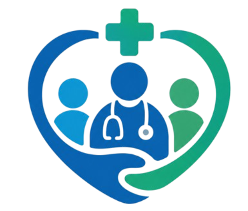

 <div align="center">



# HealthConnect
### Community Healthcare Outreach Platform

**Connecting Communities to Better Healthcare Through Salesforce**


</div>

---

## 📌 Project Overview

**HealthConnect** is a Salesforce-based community healthcare outreach platform designed to help healthcare teams manage patient information, coordinate medical case reviews, and support preventive care.

The platform connects four main user groups:

| User Role | Responsibilities |
|---|---|
| 🧑‍⚕️ **Health Workers** | Register patients, maintain patient information, and create health cases based on symptoms and medical history. |
| 🩺 **Doctors** | Review assigned cases, provide medical recommendations, and identify patients requiring follow-up care. |
| 🧑 **Patients** | Access their health information and available healthcare services through a secure Experience Cloud portal. |
| ⚙️ **Administrators** | Monitor healthcare activities and analyze cases, appointments, immunizations, and outreach performance through reports and dashboards. |

HealthConnect aims to reduce manual record keeping, improve coordination between healthcare workers and doctors, and help prevent patients from missing important vaccinations, check-ups, and follow-up visits.

---

## ✨ Key Features

### 1. Patient Management
- Register and maintain patient information.
- Store contact details, date of birth, gender, address, village, and region.
- Maintain notification preferences and consent information.

### 2. Health Worker and Doctor Management
- Maintain health worker and doctor profiles.
- Record doctor specializations and associated health centres.
- Associate healthcare professionals with healthcare centres and regions.

### 3. Health Case Management
- Create digital health cases for registered patients.
- Record symptoms, symptom duration, medical history, and severity.
- Assign cases to doctors for review.
- Track cases from submission through review, recommendations, follow-up, and closure.

### 4. Doctor Review and Recommendations
- Allow doctors to review assigned health cases.
- Record medical and medication recommendations.
- Identify cases that require another consultation or follow-up.

### 5. Appointment Management
- Manage initial consultations, follow-up visits, routine check-ups, and immunization appointments.
- Record appointment date, time, doctor, location, and status.
- Track scheduled, confirmed, completed, cancelled, and missed appointments.

### 6. Immunization Tracking
- Maintain patient vaccination records.
- Record vaccine names, dose numbers, due dates, and administration dates.
- Track planned, due, completed, overdue, and missed immunizations.

### 7. Automated Care Reminder Creation
- Use Salesforce Flow to create care reminder records for eligible immunizations, routine check-ups, and follow-ups.
- Associate reminders with relevant patients and healthcare records.
- Apply eligibility checks to help prevent reminders for completed or ineligible activities.

### 8. Reminder Monitoring
- Track reminder status and intended notification channel.
- Maintain delivery status, sent time, retry count, and error details.
- Support channel values such as SMS, WhatsApp, voice call, and Experience Cloud.

> **Note:** Creating a care reminder record does not automatically deliver an SMS, WhatsApp message, or voice call. Actual external notification delivery requires a separately configured messaging or telephony integration.

### 9. Patient Self-Service Portal
- Provide a patient-facing portal using Salesforce Experience Cloud.
- Allow authenticated patients to access the health information made available to their accounts.
- Support access to relevant health records, appointments, immunizations, and recommendations according to configured permissions.

### 10. Role-Based Access and Secure Information Sharing
- Separate access for administrators, health workers, doctors, and patients.
- Use Salesforce permissions and record-sharing configurations to control access.
- Restrict patient portal access to records associated with the authenticated patient.

### 11. Reports and Dashboards
- Present healthcare information through Salesforce reports and dashboards.
- Monitor health cases, appointments, immunization status, and care reminders.
- Support analysis of regional outreach activity and potential gaps in preventive care.

---

## 🛠️ Technology Stack

| Technology | Purpose |
|---|---|
| **Salesforce Platform** | Core cloud platform for application data, users, security, and automation. |
| **Salesforce Custom Objects & Fields** | Store patients, health workers, doctors, health centres, cases, appointments, immunizations, and reminders. |
| **Salesforce Flow Builder** | Automate health-case initialization and eligible care reminder creation. |
| **Apex** | Server-side business logic and controller functionality where implemented. |
| **Lightning Web Components (LWC)** | Build custom Lightning interfaces and dashboard experiences. |
| **SOQL** | Query Salesforce records for application logic and data display. |
| **Salesforce Experience Cloud** | Build the patient self-service portal. |
| **Profiles & Permission Sets** | Manage user permissions and record access. |
| **Salesforce Reports & Dashboards** | Present operational metrics and healthcare insights. |
| **Visual Studio Code** | Salesforce development environment. |
| **Salesforce CLI** | Authenticate, retrieve metadata, and deploy Salesforce components. |
| **Git & GitHub** | Version control and source-code collaboration. |

---

## 🗂️ Salesforce Data Model

HealthConnect uses eight custom Salesforce objects to organize healthcare information.

| Custom Object | Description |
|---|---|
| `Patient__c` | Stores patient details and notification preferences. |
| `Health_Worker__c` | Stores health worker details and health-centre association. |
| `Doctor__c` | Stores doctor details, specialization, and health-centre association. |
| `Health_Centre__c` | Stores healthcare centre information and regional details. |
| `Health_Case__c` | Stores patient symptoms, medical history, severity, case status, and recommendations. |
| `Care_Appointment__c` | Stores consultation and follow-up appointment details. |
| `Immunization__c` | Tracks vaccine details, doses, due dates, and administration status. |
| `Care_Reminder__c` | Stores reminder details, related records, intended channel, and tracking status. |

---

## 🔄 Application Workflow

```text
        Patient Registration
                 |
                 v
       Health Worker Creates
             Health Case
                 |
                 v
        Case Submitted for
              Review
                 |
                 v
          Doctor Reviews
             the Case
                 |
                 v
       Medical Recommendations
                 |
                 v
       Appointment / Follow-up
             Scheduling
                 |
                 v
       Immunization & Care
          Tracking
                 |
                 v
       Automated Reminder
             Creation
                 |
                 v
       Patient Experience
              Portal
                 |
                 v
       Reports & Dashboards
```

### Workflow Explanation

1. A health worker registers a patient.
2. The health worker creates a health case and records symptoms and medical history.
3. The case is submitted and assigned to a doctor.
4. The doctor reviews the case and records recommendations.
5. An appointment or follow-up is scheduled when required.
6. Immunization and care records are monitored for upcoming or overdue activities.
7. Salesforce Flow creates eligible care reminder records.
8. Patients access permitted information through the Experience Cloud portal.
9. Administrators monitor healthcare activities and identify outreach gaps through reports and dashboards.

---

## 🎯 Project Objective

The objective of HealthConnect is to support more organized, accessible, and proactive community healthcare by bringing patient records, medical case management, preventive-care tracking, reminders, and healthcare reporting together on the Salesforce platform.

---

<div align="center">

### HealthConnect
**Connecting Communities to Better Care 💙**

*Outreach Programme | Salesforce-Based Healthcare Solution*

</div>
